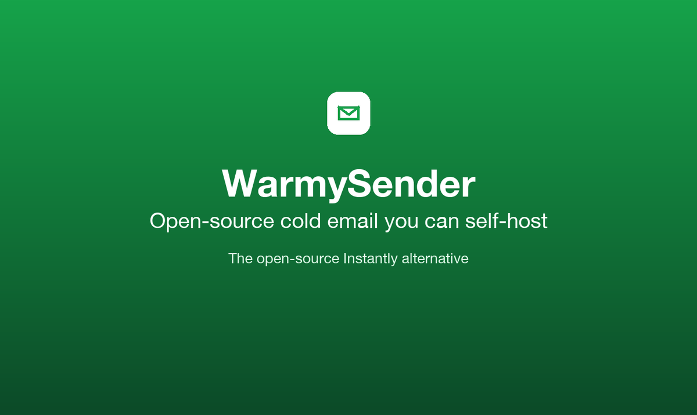

<p align="center">
  
</p>

# WarmySender — open-source cold email

Open-source cold email you can self-host. The open-source Instantly alternative.

**Hosted version: WarmySender — adds warmup, email verification, leads and LinkedIn. New accounts get Pro at $9/month with the sign-up offer → https://warmysender.com**

[](LICENSE)
[](https://github.com/warmysender-oss/warmysender/releases)
[](https://github.com/warmysender-oss/warmysender/actions/workflows/ci.yml)
[](https://github.com/warmysender-oss/warmysender/stargazers)
[](https://github.com/warmysender-oss/warmysender/pkgs/container/warmysender)

## Demo



Seeded demo data uses `.test` domains only.

## Features

- `docker compose up` runs the app, the worker, and PostgreSQL. Jobs stay in Postgres through pg-boss.
- Email and password accounts. The first visitor is the admin and invites teammates by link.
- API keys (create, name, revoke). A key is shown once and stored hashed.
- Any SMTP/IMAP mailbox, with presets for Gmail / Google Workspace (App Password), Zoho, Hostinger, Fastmail, and custom hosts, plus Microsoft 365 / Outlook through the self-hoster's own Entra app.
- Per-mailbox daily cap, sending window, random gap, and a ramp for new mailboxes.
- CSV import, lists, and a global suppression list.
- Sequences with variables and fallbacks, same-thread follow-ups, and a launch check that lists problems in words.
- v1 sends the message as you wrote it, with `List-Unsubscribe` and one-click unsubscribe, and without open or click tracking.
- A unified inbox. A real reply stops the sequence. Auto-replies are labeled and do not stop it. Bounces are suppressed.
- Stats per campaign, step, and mailbox.
- REST API (`/api/v1`) and MCP (`/mcp`) for Claude, ChatGPT, Cursor, Codex, OpenClaw, Hermes Agent, and any other MCP client.
- Optional WarmySender connect for list verification, mailbox warmup, and a leads-search link. The core app runs with no WarmySender key.
- A DNS deliverability check (SPF, DKIM, DMARC, MX) on each mailbox, and `pnpm doctor` / `docker compose run app doctor`.

## Works with your AI agent

Claude, ChatGPT, Cursor, Codex, OpenClaw, Hermes Agent, and any client that speaks MCP. Connection snippets for all six are in [docs/agents.md](docs/agents.md).

```bash
npx skills add warmysender-oss/warmysender
```

Fork it and have your agent build the tool you want. Layout and commands for that agent live in [AGENTS.md](AGENTS.md) and [CLAUDE.md](CLAUDE.md).

## Quick start

### Let your agent set it up

Paste this into Claude Code, Codex, or Cursor:

```text
Set up open-source WarmySender from https://github.com/warmysender-oss/warmysender in this folder.

1. Clone the repository if it is not already here.
2. Copy .env.example to .env and fill every variable that file documents. Do not commit .env. Demo and test addresses use .test domains only.
3. Start the stack with `docker compose up`.
4. Open http://localhost:3000. The first account becomes the admin.
5. Leave the sending caps, window, gap, and ramp as they are. Agents create and start campaigns. The scheduler sends. An agent cannot raise a limit, and a reply draft stays a draft until a person sends it from the inbox.
```

### Or do it yourself

1. Clone the repository and move into it.

   ```bash
   git clone https://github.com/warmysender-oss/warmysender.git
   cd warmysender
   ```

2. Start the stack. On a laptop, Compose supplies development defaults, so a `.env` file is optional. `NODE_ENV=production` refuses those defaults.

   ```bash
   docker compose up
   ```

3. Open http://localhost:3000 and create the first account. That account is the admin.

Before you expose the server, copy `.env.example` to `.env` and set `ENCRYPTION_KEY` and `SESSION_SECRET` the way that file describes (`openssl rand -base64 32`). Details, including Coolify, Dokploy, Portainer, and Railway, are in [docs/self-hosting/README.md](docs/self-hosting/README.md).

Release tags publish `ghcr.io/warmysender-oss/warmysender`. The Compose file in the repo builds the local `Dockerfile` (`build: .`).

## Safe by default

Limits are code. An agent cannot raise them.

- Each mailbox sends at most its daily cap. The default is 30. The hard maximum is 50.
- A new mailbox ramps: 10 a day on days 1–7, 20 a day on days 8–14, then that mailbox's own cap.
- Sends happen only inside the mailbox's sending window and timezone, and only after a random gap since its last send (default 4–9 minutes). One email at a time per mailbox.
- A real reply stops that contact's sequences. A bounce suppresses the contact. Suppressed contacts are skipped.
- Every email can be unsubscribed in one click (`List-Unsubscribe` and `List-Unsubscribe-Post`).
- MCP and API tools create and start campaigns. The scheduler sends. Reply drafting saves a draft a person sends from the inbox.

## Open source vs WarmySender Cloud

| | Open source (self-host) | WarmySender Cloud |
| --- | --- | --- |
| Cold email sequences | Yes | Yes |
| Unified inbox | Yes | Yes |
| REST API | Yes | Yes |
| MCP for AI agents | Yes | Yes |
| Warmup network | Connect a WarmySender key | Yes |
| Email verification | Connect a WarmySender key | Yes |
| Leads database | Connect a WarmySender key | Yes |
| LinkedIn | — | Yes |
| Instagram | — | Yes |
| Managed hosting | — | Yes |

## WarmySender open source vs hosted cold email tools

Instantly, lemlist, and Smartlead are closed-source hosted services. This repository is self-hosted cold email under the GNU AGPL-3.0. The hosted column is Closed source or Hosted only.

| | WarmySender (open source) | Instantly, lemlist, Smartlead (hosted) |
| --- | --- | --- |
| Source code open | Yes. This repository. | Closed source |
| Self-host on your own server | Yes. `docker compose up` runs the app, the worker, and PostgreSQL 16 on a machine you control. | Hosted only |
| Licence | [GNU AGPL-3.0](LICENSE) | Closed source |
| Your data stays on your server | Yes for the app you run. Accounts, contacts, messages, and mailbox secrets stay in your Postgres database. Secrets are encrypted at rest. Connecting warmup sends that mailbox login to your WarmySender account. | Hosted only |
| AI agents over MCP with safe limits | Yes. Claude, ChatGPT, Cursor, Codex, OpenClaw, and Hermes Agent. Tools create and start campaigns. The scheduler sends. A tool cannot raise a limit or send a message. | Hosted only |
| Warmup network | No warmup network in this app. Warmup is a WarmySender Cloud feature you connect with a key. | Hosted only |

## Costs

Self-hosting costs your server and your mailboxes. WarmySender features (warmup, verification, leads, LinkedIn) cost your WarmySender plan. New accounts get Pro at $9/month with the sign-up offer → https://warmysender.com

## Self-hosting

- [Docker Compose](docs/self-hosting/docker.md)
- [Coolify, Dokploy, and Portainer](docs/self-hosting/coolify-dokploy-portainer.md)
- [Railway](docs/self-hosting/railway.md)
- [Microsoft 365 / Outlook app](docs/MICROSOFT-APP.md)
- [Connect an agent](docs/agents.md)
- [Cutting a release](docs/RELEASING.md)
- [Documentation index](docs/README.md)
- [FAQ](docs/faq.md)

## FAQ

### Is there a free open-source alternative to Instantly?

Yes. This repository is open-source cold email you self-host, under the GNU AGPL-3.0, with no licence fee. Instantly is a closed-source hosted service. You run the sequences, inbox, REST API, and MCP server on your own machine. Warmup, verification, leads, and LinkedIn stay on the hosted WarmySender plan linked above.

### Can I self-host cold email software?

Yes. WarmySender is self-hosted cold email. `docker compose up` starts the app, the worker, and PostgreSQL 16, and http://localhost:3000 is the UI. The first account is the admin. Docker, Coolify, Dokploy, Portainer, and Railway are documented in [docs/self-hosting](docs/self-hosting/README.md).

### What do I need to run it?

Docker with Compose v2 is the supported install, and a source checkout uses Node 22, pnpm, and PostgreSQL 16. You bring your own mailboxes. Before you expose the server, set `ENCRYPTION_KEY` and `SESSION_SECRET` the way `.env.example` describes. `NODE_ENV=production` refuses the development defaults published in the Compose file.

### Does it work with Gmail and Outlook?

Yes. Gmail and Google Workspace connect over SMTP and IMAP with an app password, and the same form has presets for Zoho, Hostinger, Fastmail, and a custom host. Microsoft 365 and Outlook use an Entra app you register for your own server. The steps are in [docs/MICROSOFT-APP.md](docs/MICROSOFT-APP.md).

### How does it keep my mailboxes safe?

The limits are code, and an agent cannot raise them. Each mailbox sends at most its daily cap (default 30, hard maximum 50), and a new mailbox ramps at 10 a day on days 1–7 and 20 a day on days 8–14. Sends stay inside that mailbox's window and time zone, one at a time, after a random gap (default 4–9 minutes). A real reply stops that contact's sequences, a bounce suppresses the contact, and three sign-in failures in a row pause the mailbox.

### Can AI agents like Claude or ChatGPT run my campaigns?

Yes. Claude, ChatGPT, Cursor, Codex, OpenClaw, and Hermes Agent connect over MCP at `/mcp` with an API key, and the same actions are on the REST API. Those tools create and start campaigns. The scheduler sends, inside the caps, window, gap, and ramp, and a reply tool saves a draft a person sends from the inbox. Snippets for all six are in [docs/agents.md](docs/agents.md).

### Does it do email warmup?

Warmup is a WarmySender Cloud feature you can connect with a key. This app does not run a warmup network, and sequences, the inbox, and the scheduler work with no key. For an SMTP or IMAP mailbox, Settings asks you to confirm before the mailbox login is sent to your WarmySender account. Microsoft mailboxes are warmed by signing in inside WarmySender.

### Is it really free?

The software is free to run, and there is no licence fee for this repository. Self-hosting costs your server and your mailboxes. Warmup, email verification, leads, and LinkedIn use a WarmySender plan. New accounts get Pro at $9/month with the sign-up offer at https://warmysender.com.

### What licence is it?

GNU Affero General Public License v3.0. You can run, study, and change the code. If you run a modified version as a network service, the AGPL requires you to offer the corresponding source to users of that service. The text is in [LICENSE](LICENSE).

### How is it different from Instantly, lemlist or Smartlead?

You self-host this program, the source is AGPL-3.0, and the database stays on your server. Instantly, lemlist, and Smartlead are closed-source hosted services. People looking for a lemlist alternative or a Smartlead alternative get the same deal as the Instantly alternative in the first line: your server, your mailboxes, and MCP for Claude, ChatGPT, Cursor, Codex, OpenClaw, and Hermes Agent, with the limits above. Their features and prices are outside this page.

## Contributing

See [CONTRIBUTING.md](CONTRIBUTING.md). Checks for this repo:

```bash
pnpm typecheck
pnpm lint
pnpm test
```

## Community

Questions and ideas go to [GitHub Discussions](https://github.com/warmysender-oss/warmysender/discussions).

## Star the repository ⭐

If this is useful, star [warmysender-oss/warmysender](https://github.com/warmysender-oss/warmysender/stargazers).

## Security

Report vulnerabilities through https://warmysender.com/support (see [SECURITY.md](SECURITY.md)). Do not open a public issue for a security problem.

## License

[GNU Affero General Public License v3.0](LICENSE). If you run a modified version as a network service, the AGPL requires you to offer the corresponding source to users of that service.

Support for the project and the hosted product: https://warmysender.com/support
